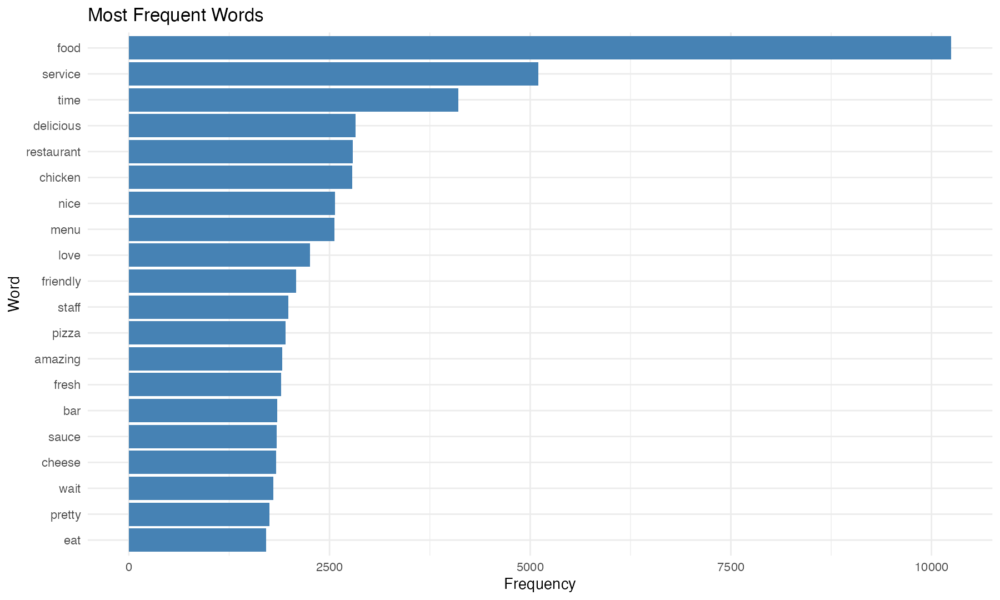
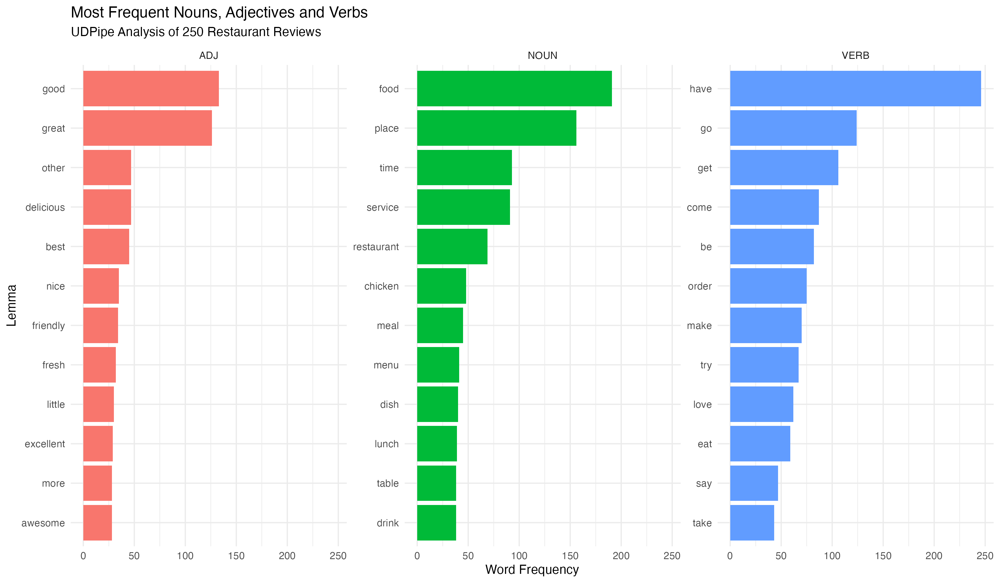
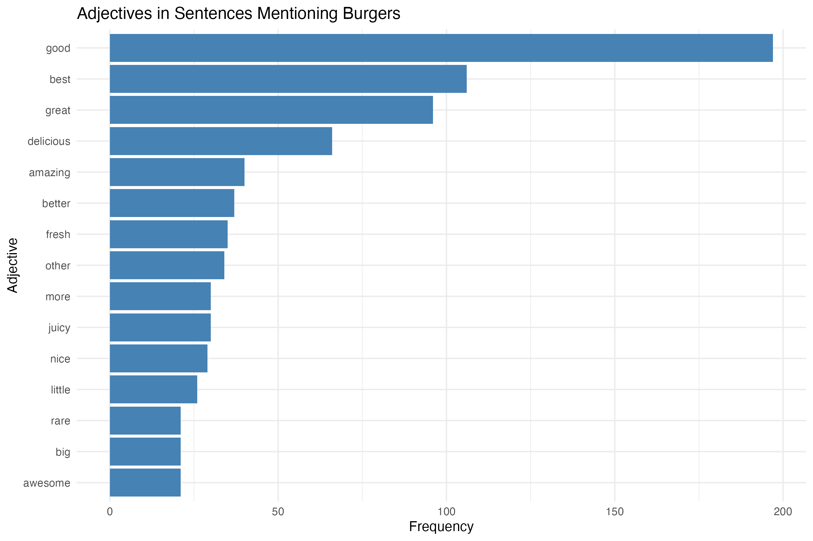
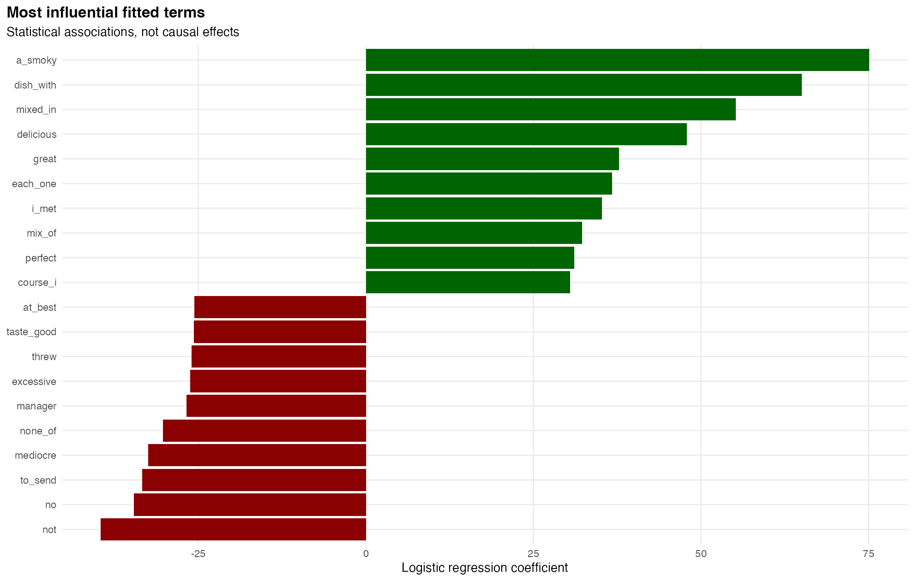

# Customer Review Analytics in R

**A two-session, hands-on seminar on text mining, sentiment analysis, linguistic annotation, and supervised machine learning.**

The project analyzes a sample of English-language restaurant reviews with R. It starts with exploratory NLP and dictionary-based sentiment, then builds a **TF-IDF + L1-regularized logistic regression** classifier to predict **review-rating polarity**. A separate UDPipe exercise identifies nouns, adjectives, verbs and product-related descriptions.

> **Data note:** This repository contains course code, lecture slides, and selected aggregate figures/tables. It **does not include raw review text, the source CSV, review-level predictions, RStudio cache files, or the downloaded UDPipe language model**. Public release of Yelp-derived results may require additional review under the relevant dataset terms; see [Data use and limitations](docs/DATA_AND_LIMITATIONS.md).

## At a glance

| Study | Result |
|---|---:|
| Usable reviews | 14,350 |
| Cities in sample | 366 |
| Review-level Spearman correlation: normalized Bing vs stars | 0.513 |
| Training reviews | 1,920 |
| Held-out test reviews | 480 |
| Logistic regression accuracy | **91.88%** |
| Logistic regression F1 | **0.919** |
| Logistic regression ROC AUC | **0.969** |
| Logistic regression Brier score | **0.0795** |
| Bing dictionary accuracy (abstentions counted as errors) | **68.96%** |

The same balanced test set is used for both classification methods. **Star ratings** define the target: 1–2 stars = negative, 4–5 stars = positive; 3-star reviews are excluded. These values are *observed results from one split*, not claims of generalizable accuracy. See [Methodology](docs/METHODOLOGY.md).

## Example visualizations

| Text exploration | POS tagging and lemmatization |
|---|---|
|  |  |

| Burger-related adjectives | Logistic regression coefficients |
|---|---|
|  |  |

The burger plot is **sentence-level co-occurrence**: an adjective appearing in a burger sentence is not necessarily describing the burger. A stricter `amod` dependency extraction is also included in Script 04.

## Analytical workflow

```text
Yelp reviews (download separately)
             |
    Import + quality audit               01_import_audit.R
             |
  Tokens / bigrams / TF-IDF             02_text_exploration.R
             |
  Bing sentiment / negation             03_sentiment_and_negation.R
             |
  UDPipe POS / lemmas / burger          04_udpipe_pos_optional.R
             |
  TF-IDF + L1 logistic regression       05_supervised_model.R
             |
  Final course summary                  06_export_review_pack.R
```

The logistic model uses a sparse document–term matrix of **unigrams and bigrams**. Vocabulary and IDF are fitted **only on training reviews**, and the regularization parameter is chosen with **5-fold cross-validation on the training data**.

## Run in RStudio

1. Install [R](https://cran.r-project.org/) and [RStudio](https://posit.co/download/rstudio-desktop/), then open `Customer_Reviews_Course.Rproj`.
2. Obtain the dataset from the [Zenodo record (DOI 10.5281/zenodo.18723813)](https://zenodo.org/records/18723813), subject to its applicable terms. Extract the CSV to **`data/raw/yelp_sentiment_master_dataset.csv`**.
3. Run `source("scripts/00_setup.R")` to install R packages. Script 04 will download an English UDPipe model into the ignored `models/` folder **on first use only** (internet required).
4. Run the scripts in order or run them all together:

```r
source("scripts/run_all.R")
```

Generated tables, figures, and the final bundle appear in `outputs/`. You can run each script separately in RStudio to inspect its intermediate objects. **The raw dataset and local outputs are ignored by Git.**

For complete setup notes and dependencies, see [Reproducing the analysis](docs/REPRODUCIBILITY.md).

## What is included?

```text
scripts/            Classroom-friendly, commented R scripts (00 to 06; run_all.R)
slides/             Lecture 1 and Lecture 2 PDF presentations
results/figures/    Selected plots from the completed course analysis
results/tables/     Selected aggregate CSV summaries (not raw review rows)
results/            Short completed-course summary
models/             Local English language model goes here (not committed)
data/raw/           Download the dataset here (not committed)
outputs/            Local run outputs (not committed)
docs/               Methodology, instructions, and data-use notes
```

## Teaching materials

- [Lecture 1 — Foundations and Business NLP (PDF)](slides/Lecture_1_Foundations_and_NLP.pdf)
- [Lecture 2 — Predictive Sentiment and Interpretation (PDF)](slides/Lecture_2_Predictive_Sentiment.pdf)

## Interpretation and limitations

- The task predicts **rating-derived binary labels**, not independently validated emotional sentiment.
- Bing counts matched positive and negative words. A zero score results in **abstention**, counted as an incorrect classification in the reported baseline accuracy.
- Logistic regression learns coefficients from training reviews; selected terms indicate **associations, not causal effects**.
- Balanced sampling changes the class prevalence from the original corpus. Reported accuracy and probability calibration may change under a natural prevalence.
- The evaluation uses one random train/test split of a sample of reviews. A restaurant-level holdout would be a valuable additional robustness check.
- UDPipe noun/adjective/verb summaries and burger co-occurrence provide exploratory linguistic insights, not independent validation of the classification model.

## Data source and attribution

Original sample extract: [*Yelp Restaurant Reviews Sentiment Dataset* (Zenodo)](https://zenodo.org/records/18723813), DOI: [10.5281/zenodo.18723813](https://doi.org/10.5281/zenodo.18723813). The underlying text derives from the Yelp Open Dataset; its terms of use are separate from any license applicable to the analysis code. This project is **not affiliated with or endorsed by Yelp**.

### License and data use

The original R scripts in this repository are released under the MIT License. See [LICENSE](LICENSE).

The Yelp restaurant-review dataset is not included and is not covered by the MIT License. Original data and any dataset-derived materials remain subject to their applicable terms of use.

Dataset source: [Yelp Restaurant Reviews Sentiment Dataset](https://doi.org/10.5281/zenodo.18723813).

If you use this project for academic or educational purposes, please acknowledge the repository and its author.
